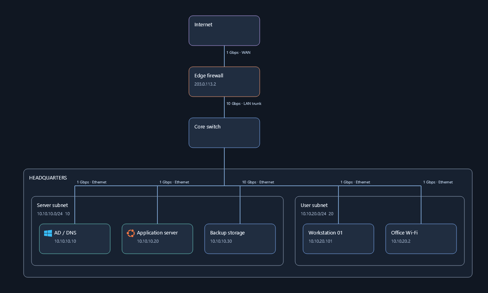
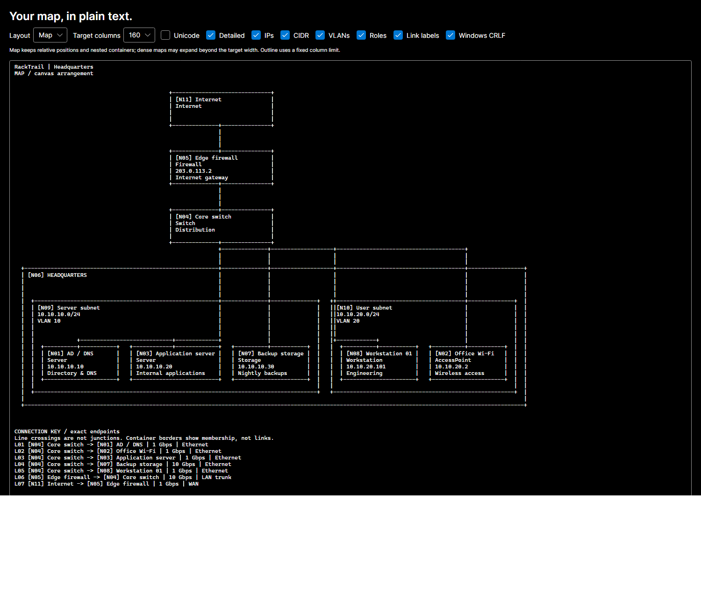

# RackTrail

<picture>
  <source media="(prefers-color-scheme: dark)" srcset="docs/images/brand-dark.png">
  <source media="(prefers-color-scheme: light)" srcset="docs/images/brand-light.png">
  
</picture>

RackTrail is a Windows desktop app for building and maintaining network maps. Document sites, subnets, devices and connections, discover devices on selected IPv4 targets, and export maps as text, SVG or PNG. Everything stays local, with no account or cloud service required.

[Download RackTrail for Windows x64](https://github.com/xotan135/RackTrail/releases/latest) · [Version history](CHANGELOG.md)

## Editing larger maps

- **HTML** exports a single file you can open in a browser or share. Device
  pictures are embedded; an internet connection and RackTrail are not required.
  Drag to pan, scroll to zoom, use **Fit map** or **100%**, and choose **Print / PDF**
  to print the whole map. The file preserves the saved layout, collapsed containers,
  routing, and connection-label setting. It is a read-only view; edit the original
  project in RackTrail. Like PNG/SVG, it contains the visible network information
  shown on the map.
- Connections automatically avoid device cards and container headings, fan out at
  device edges, and prefer gaps between unrelated sites. **Arrange > Reroute
  connections** recomputes automatic paths without moving devices or replacing
  saved custom paths. Dragging uses a fast preview; routing finishes on release.
- Select a device or container to highlight its links and dim unrelated traces.
  **View** can show connections equally or restore highlighting. Automatic labels
  appear at detailed zoom on small maps; on maps with more than 30 connections,
  hover or select a trace to see its details. **Show all connection labels** in
  View overrides this and includes all labels in PNG/SVG exports.
- Device labels center automatically when you change standard shapes or dimensions.
  In image mode, pictures keep their proportions with information beside them.
  Use the **Image size** slider for live scaling, or turn off **Show device information**
  for an image-only AP as small as 32 pixels. Pictures and these settings are embedded
  in saved maps and retained in PNG/SVG exports.
- Container and hypervisor pickers show nested full paths such as **Site West ›
  Data**, with VLAN IDs and CIDRs. Discovery uses the same hierarchy, so repeated
  names at different sites can be distinguished before assigning an item.
- **Arrange** provides Bring to front / Send to back, Fit container to contents,
  Lock / Unlock, six alignment options, and even horizontal or vertical spacing.
  Alignment uses items in the same container; spacing requires at least three.
- Clicking a library item adds it to an open spot near the current view center.
  Dragging from the library uses the drop position. New items appear on top and
  clear device filters so they remain visible. Clicks follow the visible layer order.
- Empty containers can be resized to **120 pixels high**. Containers with contents
  retain enough space for their children. Fit container to contents removes extra
  space while preserving membership and connections.
- Locks protect position, size, and deletion. Locking a container protects its
  descendants; a locked descendant also prevents moving its whole parent group.
  Auto layout asks you to unlock items first rather than changing locked positions.
- **Guides** shows matching edges and centers during a drag. **Snap** independently
  controls the existing 10-pixel grid snapping.
- Ctrl-click or drag a selection rectangle, then use **Edit subnet appearance** in
  Properties to apply a shared name, outline color, width, or height to selected
  subnets. Blank fields keep existing values. Automatic resets the custom color.
- **Ctrl+F** focuses search. Search names, IPs, CIDRs, VLAN IDs, site names, and stack
  inventory; press **Enter** or click a result to reveal and center it. Hidden
  ancestors expand automatically.
- **View** switches the entire map or selected containers between compact and
  expanded states. Compact collapses contents; expanded restores visibility without
  changing saved positions or sizes. Zoom to selected is also available here.

Layers, locks, colors, and collapsed states are saved in the project. Editing
commands support Undo/Redo. SVG and PNG exports retain layer order and colors;
older project files load with their existing appearance and unlocked items.

## Features

- Map sites, buildings, VLANs, subnets and security zones.
- Add devices, phone groups, switch stacks, hypervisor hosts and virtual machines.
- Scan chosen IPv4 subnets, IP ranges or individual addresses, with exclusions and review before importing.
- Use vendor icons or custom hardware images, embedded in saved projects.
- Validate addresses and subnet membership, then export text, Markdown, SVG or PNG.
- Work offline with portable JSON projects, undo/redo and local recovery.

Built with C#, .NET 10 and Avalonia. The supported release targets Windows x64.

## Launch the Windows release

Choose a download from [GitHub Releases](https://github.com/xotan135/RackTrail/releases/latest):

- **Installer:** run `RackTrail-Setup-<version>-win-x64.exe`. It installs for the current Windows user, adds a Start menu shortcut, offers an optional desktop shortcut and provides an uninstaller. Reinstall a newer version to update the app. Custom icons and user-created files are preserved.
- **Portable ZIP:** extract `RackTrail-win-x64.zip` and run `RackTrail.exe` from the extracted folder.

Both include the runtime, so no .NET installation is required. The downloads are unsigned. SHA256 checksum files accompany each download.

1. Download and extract `RackTrail-win-x64.zip` into a folder.
2. Run `RackTrail.exe` from the extracted folder. Keep all accompanying DLLs and runtime files together.
3. Start with an empty map, choose the sample when prompted, or use **Open** for a saved JSON project.

The release is self-contained: no .NET installation is required. Both installer and portable downloads are unsigned.

## Editing workflow

### Targeted device discovery

Click **Discover** in the toolbar, then enter the authorized IPv4 subnets, ranges or addresses to inspect, and add optional exclusions. Confirm authorization before starting. Choose SNMP Off, v1 or v2c and optional service checks to add evidence about device types, hardware, operating systems and roles.

Review each result's type, confidence and evidence before applying it to the map. Insufficient or conflicting evidence stays **Unknown**. Correct types directly in scan review, then assign a container or create a subnet beneath a chosen parent. Manual type corrections survive later scans; **Restore automatic classification** returns to the latest automatic result. Type and confidence filters and a device legend help review the map.

See [Device discovery and classification](docs/Discovery.md) for configuration, supported methods, limits and correction instructions.
### Phones

Choose **Phones** in the device library to add one card representing the phones on a subnet. Use **Container membership** to assign it to the voice subnet or VLAN, and connect it to a switch if needed. Name it for the group (for example **Office phones**) and use Notes for any additional details. Individual handset cards and IP addresses are optional. The phone symbol and card are included in saved projects and text, SVG and PNG exports.

### Printers and device icons

Printers are connectable devices in the palette and support the same properties,
subnet membership, validation and exports as other devices.

The `icons` folder beside the executable is editable by end users. Copy PNG or JPG
files into it and they appear automatically in the device's **Device icon** dropdown
within a few seconds. Use **Open icons folder** to find it and **Reload icons** to
refresh immediately or see skipped-file diagnostics. Use transparent square PNGs
for best results. Files must be no larger than 4 MB or 2048 × 2048 pixels. SVG is
used for bundled vectors but is not imported from the end-user folder.

Set **Vendor** (for example Cisco or HP) or **Operating system** (Windows Server,
Gentoo Linux, Ubuntu or Debian). With **Automatic** selected, the app matches those
fields to filenames, ignoring case, spaces and punctuation. Vendor matches take
precedence over OS matches. `acme.png` matches Vendor `Acme Corp`. Choose an icon
manually to override automatic matching, or choose **Standard device icon** to use
the device symbol. Unrecognized names use the standard symbol.

Cisco, Windows, Gentoo, Linux, Ubuntu, Debian, Apple, HP, Dell and Ubiquiti logos
are bundled and work offline. End users can replace their folder PNGs or add any
other vendor. Selected images are embedded in saved JSON projects, so moved
projects keep their icons without machine-specific paths. SVG and PNG exports
include those icons. The **About** button displays the actual application version
and bundled [version history](CHANGELOG.md). Version 1.2.0 adds these features.

If the extracted installation is in a protected folder, the user must have write
access to add icons. The application itself works with its bundled icons there.

- Click a device in the left palette to add it, or drag it onto the canvas. Select the container kind and choose **Add container** for sites, buildings, VLANs, subnets and security zones.
- Click a node and edit its name, hostname, IPs, operating system, role and notes in the properties panel. Separate multiple addresses with commas. Property text commits when focus leaves the field; clicking Save commits the focused field.
- Use **Container membership** to assign devices or subnets to a container. This relationship is independent of network connections. Moving a container also moves its descendants. Container width and height are editable near the bottom of its properties.
- Choose **Connect**, click the first device, then the second. Click a connection segment to edit ports, protocol, bandwidth and purpose. Press Escape to cancel connection mode.
- Drag nodes to reposition them. Ctrl-click toggles selection; drag empty canvas for region selection. Use **Align top** or **Align left** with multiple selected nodes. The grid snaps to 10 model units when enabled.
- Mouse wheel zooms around the pointer. Middle or right drag pans. **Fit** centers the map; **Auto layout** arranges the device backbone and nested containers and recalculates routes.
- Double-click a container to collapse or expand it, or use its properties button. Connections to hidden descendants terminate at the collapsed container.
- Search the explorer by name, address, role or CIDR; click a result to select and locate it.
- **Validate** reports invalid IP addresses, duplicate addresses, overlapping subnets, outside-subnet devices, invalid gateways and VLAN IDs. IPv4 and IPv6 are supported. **Allow validation exceptions** marks warnings as intentional. Warnings never block saving.
- **Theme** toggles light and dark modes.

| Shortcut | Action |
| --- | --- |
| Ctrl+S / Ctrl+Shift+S | Save / Save as |
| Ctrl+O | Open |
| Ctrl+Z / Ctrl+Y | Undo / Redo |
| Ctrl+C / Ctrl+V | Copy / Paste selected nodes, descendants and internal links |
| Ctrl+A | Select all visible nodes |
| Delete | Delete selected nodes or connection |
| Escape | Cancel connection mode and clear selection |

Text-field copy/paste and selection keep their normal behavior. Copy/paste of map objects uses an internal clipboard; text exports use the system clipboard.

## Stacked switches

Choose **Switch stack (5 members)** in the palette, or select an existing switch and **Convert to 5-member stack**. The stack is a single logical switch with one shared management hostname, IP address and SSH/HTTPS interface address. It does not store login passwords or connect to the hardware.

Expand each member in the properties panel to record its member number, name, model, serial number, active/standby/member role, documented status and notes. Add or remove members as needed. Counts are configurable; the editor does not enforce a particular Cisco model's hardware limits or infer live status.

Select a connection to assign its **From** and **To** endpoints to physical stack members and enter their ports, for example member 3 and `Gi3/0/24`. Selecting **Entire stack / unspecified** retains a logical stack-level link. Member identities are stable, so renumbering a member preserves its connections; free-text port names are not automatically rewritten. A member with assigned connections cannot be removed until its connections are reassigned. Duplicate member numbers and missing member references are reported by validation.

**Show members on canvas** expands the stack card and draws assigned connections at their member rows. ASCII/Unicode detailed exports include member inventory and assigned ports, while overview exports summarize the member count. SVG/PNG follow the canvas member visibility. Existing projects remain readable; use this RackTrail version to save stack-aware projects, since older application versions do not preserve the new metadata.

## Save and recovery

Projects are versioned, readable JSON, with portable identifiers and no machine paths. Geometry, properties, container membership, collapse state, validation exceptions, connection metadata and route points are serialized. Saving writes a temporary file beside the destination and atomically replaces the destination. Unsupported versions, missing endpoints and container cycles are rejected on load.

Unsaved changes are autosaved every 30 seconds to the platform's local application-data directory under `RackTrail/recovery.racktrail.json`. On Windows this is normally `%LOCALAPPDATA%/RackTrail`. The next launch offers to restore this snapshot. Normal saves clear the snapshot. Recovery is a single latest snapshot; run one editor instance at a time. New/open/close prompt to save unsaved work.

## Text and visual exports

**Text export** opens a live monospaced preview. The default **Map** layout follows the canvas: devices keep their relative left/right and top/bottom placement, containers enclose their members, and collapsed containers hide their descendants. Sparse gaps are compressed and card labels wrap so the result remains readable.

Actual connections are drawn between visible endpoints. A connection key retains endpoint names, ports, bandwidth and purpose without crowding the drawing. Crossings do not imply junctions. Dense diagrams can have connections listed in the key without a drawn route when there is no clear route.

Choose a target of 80, 120 or 160 columns. Map layout may expand beyond that target to preserve readable cards and containment; use the horizontal scrollbar for wider maps. Choose **Outline** when a strict column limit is required: it retains the original topology tree, detailed hierarchy and connection ledger.

Both layouts support ASCII or Unicode, overview or detailed content, IPs, CIDRs, VLANs, roles, link labels and Windows CRLF or Unix LF line endings. Export as text, fenced Markdown or clipboard text. Map layout follows the stack member visibility on the canvas; Outline retains full stack inventory in detailed mode. ASCII is best for terminals with uncertain Unicode character widths.

**SVG** produces a scalable model-based vector drawing; **PNG** uses SkiaSharp. Both preserve positions and visible routes and honor collapsed containers. PNG dimensions are capped at 10,000 pixels per axis to bound memory use. The UI bundles Inter. PNG and SVG use platform sans-serif font fallback, so font metrics can differ slightly across systems.

## Build from source

See [BUILD.md](BUILD.md) for prerequisites, build and verification commands, installer packaging, and GitHub Actions releases.

## Current limits

Automatic routing uses obstacle avoidance, bend, shared-lane and crossing costs;
it cannot guarantee a crossing-free diagram. Irregular large maps use smaller
local routing grids instead of abandoning obstacle avoidance for the whole map.
Overlapping devices, blocked attachment points, or extreme routing budgets can
still require simple fallback paths. Device spacing matters on dense maps. Stored custom route
points are rendered and preserved; the UI provides a reset command without a
waypoint editing tool. Large-map PNG/SVG exports hide connection labels by
default. Connection captions use free space outside device and container names;
captions that cannot fit are omitted, and full details remain in connection properties.
Small gaps at trace crossings distinguish a crossing from a connection. The current
release has no code signing, automatic physical-link mapping or multi-user editing.

### Device images and canvas controls

Select a device, enter its Model (for example `U6 Pro`), and choose its Device icon. Click **Use device image** to replace the card shape; **Use standard shape** restores it. Add a PNG/JPG model image such as `u6pro.png` to the install `icons` folder, then select Automatic or that image. Vendor logos remain available; supply a model image to show the actual hardware. Images are embedded in saved projects.

Drag selected nodes by the blue bottom-right handle to resize them, or drag the vertical panel dividers to resize the sidebars. Pan with the middle/right mouse button and zoom with the wheel. Free nodes can move left or above the origin; Fit and exports include them. Assigned nodes stay inside their containers, which expand as needed on assignment.

Add a Hypervisor (default Hyper-V), then use **Add virtual machine** or assign a VM through its Hypervisor host selector. This creates a hosting link and places it inside the host. Network connections can be added separately. VM container membership can also be changed to a subnet while retaining its host relationship.

RackTrail starts with an empty map and asks whether to load the sample. **Don't ask again** suppresses that prompt on future launches; it always starts blank unless you explicitly restore recovery. **Load sample network** remains available in the Properties panel when nothing is selected.

## License

RackTrail is licensed under the [MIT License](LICENSE).

Copyright (c) 2026 John Turner. Third-party components retain their own licenses and notices; see [THIRD-PARTY-NOTICES.md](THIRD-PARTY-NOTICES.md) and the [licenses](licenses) directory.
