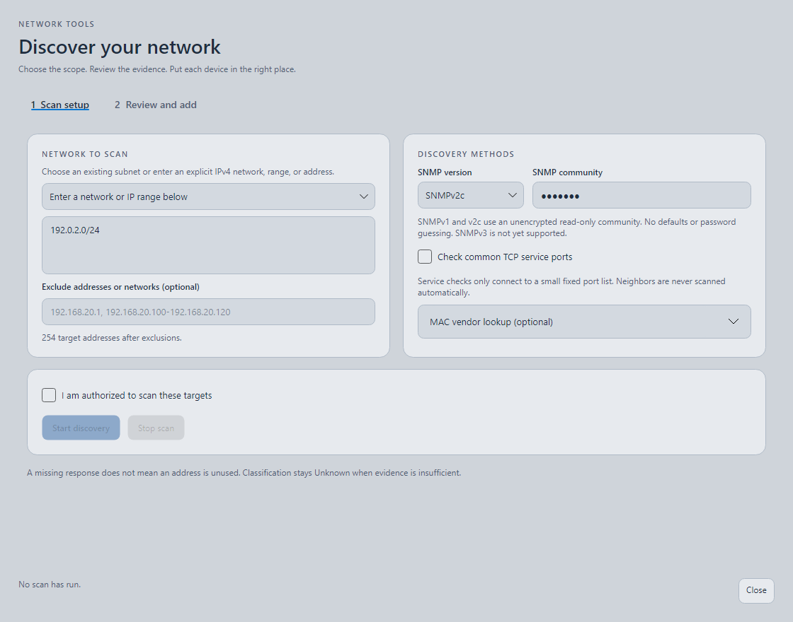
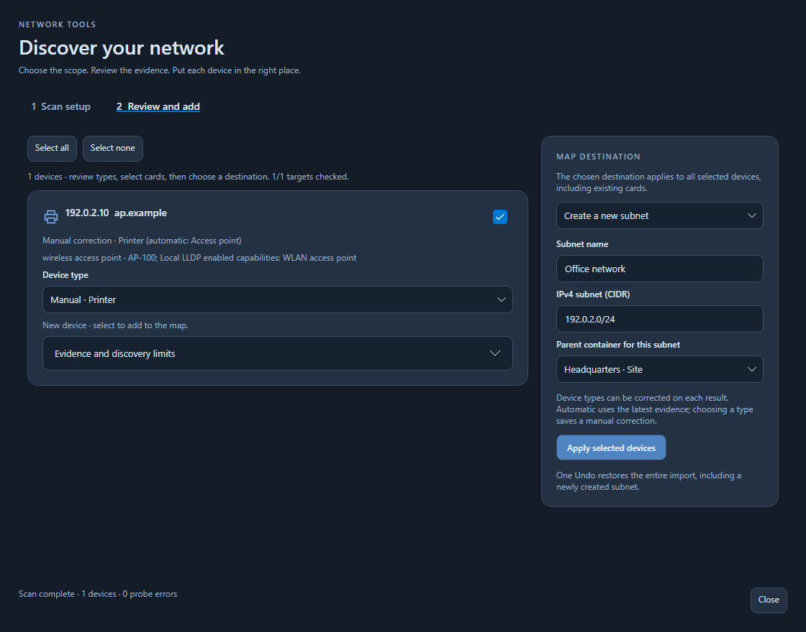

# Device discovery and classification

Use **Discover** in the toolbar or **Discover network** in the device library only for networks you are authorized to inspect. Enter explicit IPv4 subnets, ranges, or addresses and optional exclusions. In **1 Scan setup**, choose an existing subnet or enter the target network/range, add exclusions, confirm authorization and click **Start discovery**. A scan never follows addresses advertised by neighbors.

## Optional checks

The **Discovery methods** card in **Scan setup** keeps the SNMP version and community visible:

- **Service checks:** makes TCP connections to ports 22, 53, 80, 443, 445, 631, 1883, 3389, 5060, 5061, 8883 and 9100. It sends no login or application requests. An accepting port is a possible service clue, not proof of a protocol or device type.
- **SNMP:** select **Off**, **SNMPv1** or **SNMPv2c**. When enabled, enter the configured read-only community. There is no default community, fallback credential, password guessing or SET operation. Credentials stay in the open scan window's session and are not saved in project files. SNMPv1/v2c send their community without encryption; use it only on trusted networks. SNMPv3 is not supported in this version.
- **MAC vendors:** optionally load a local UTF-8 CSV under 1 MB, one OUI,vendor entry per line, such as 00-11-22,Example Networks. No vendor database is downloaded. MAC addresses come from the Windows neighbor cache or accessible SNMP interfaces; routed hosts often have no available MAC. Locally administered MACs are not assigned an OUI vendor.

SNMP reads system identity, descriptions, ENTITY-MIB manufacturer/model, interface types and physical addresses, IP forwarding, bridge ports, HOST-RESOURCES printer resources, and local LLDP enabled capabilities. It also reads bounded LLDP/CDP neighbor tables. A neighbor's capabilities apply only to a uniquely matched scanned target, using an exact management IP, MAC, or fully qualified hostname. A short name alone does not establish identity. Neighbor records remain visible in device details; they do not create map connections automatically.

OS information is extracted from management descriptions when present. The app does not perform active TCP-stack OS fingerprinting. Devices that only expose HTTPS or hide management data may remain Unknown.

Missing credentials, unsupported tables, timeouts, empty neighbor tables, missing MAC data and truncated results are shown as limitations. Unsupported SNMPv3-only networks can still use ping/DNS and optional service checks.

## Reading results

Each result shows its primary type, confidence, evidence explanation, known vendor/model/OS, possible roles and limitations. Supported primary types include server, switch, router, firewall, access point, printer, workstation, individual phone, IoT and Unknown. Existing storage, hypervisor, VM and grouped Phones cards remain available.

- **High:** strong identification is corroborated by another fresh evidence category; historical results do not increase this confidence.
- **Medium:** a supported management identity or explicit advertised capability identifies the type.
- **Low:** evidence is insufficient or conflicting; automatic type is Unknown.

MAC vendor alone never determines the type. Hostnames and port clues are weak and do not become definitive through repeated observations or multiple ports from the same source. Routing, bridging, wireless, printing and possible network services are tracked as roles separately. A Layer 3 switch remains a switch with a Routing role. A Linux bridge or forwarding host is not automatically called a hardware switch or router. An attached printer resource adds a Printing role without turning a print server into a printer. Conflicting strong identities produce Unknown and an explanation.

## Applying and correcting results

When the scan finishes, **2 Review and add** opens. Each result has a selection checkbox and a **Device type** dropdown. Choose **Automatic** to use the latest assessment (clearing any saved correction), or choose a manual type to save your correction. Existing manual corrections are selected by default. Device types protected by host, child or stack relationships must be changed on the map first.

Choose the destination for selected cards:

- **Keep existing / no container for new:** existing memberships stay in place; new cards are placed outside containers.
- **Assign to an existing container:** select a site, building, VLAN, security zone or subnet. This moves existing selected devices too.
- **Create a new subnet:** enter a name and IPv4 CIDR, then choose its parent container or the top level. The subnet and selected cards are created together.

Click **Apply selected devices**. If any selected IP is outside the destination subnet, nothing is imported until you correct the destination or selection. New subnet parents must be outside other subnets. Existing names, notes and manually entered details are preserved. One Undo restores the entire import, classification corrections, membership changes and new subnet. After creation, the new subnet becomes the destination for remaining cards.

Select a mapped device to inspect confidence, discovered hardware/OS, roles and the expandable **Discovery evidence** section. Change its device type to make a manual correction, or choose **Keep current type (manual)** to retain the current result. The correction survives save/reopen and later scans, while the latest automatic assessment is still stored. Choose **Restore automatic classification** to apply that latest assessment again.

Existing projects remain readable without conversion. Their original inventory types are preserved as operator-owned choices during rescans. Prior automatic observations younger than 30 days are weak historical evidence, not independent new proof. A changed MAC suppresses reuse of historical automatic identity and displays a review warning. A manual correction stays attached to its inventory card; review it if an address is reused.

Use the type and confidence filters in Network Explorer to filter both the list and canvas. The expandable legend explains the symbols and confidence levels. Filters do not delete devices or alter saved projects. Exports contain the full project.

## Scan limits

Scans accept at most 1,024 explicit IPv4 addresses, with eight concurrent targets and at most two service connections per target. TCP checks time out after 450 ms, SNMP reads after 800 ms, and optional collection has a ten-second budget per target. SNMP walks read at most eight rows per column (four for hardware identity) and at most 96 requests per host. Incomplete results are labeled.

Results are cached for five minutes within the open scan window. Changing credentials, service options or the MAC vendor file clears that session cache. Close and reopen the scan window to force fresh collection. Cancel stops remaining work and keeps already completed devices for review. No response never proves that an address is unused.
